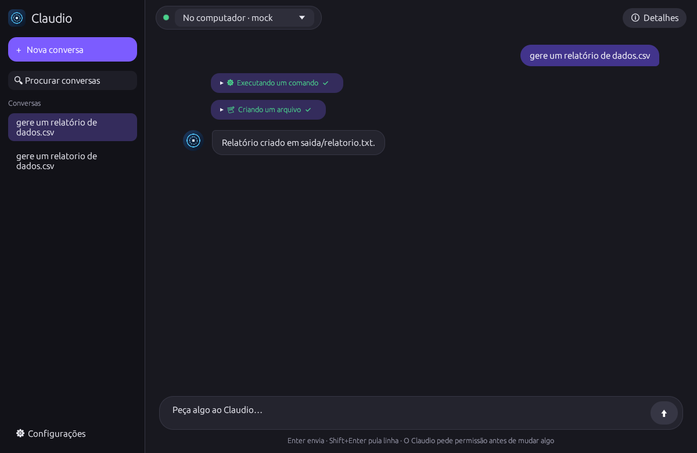
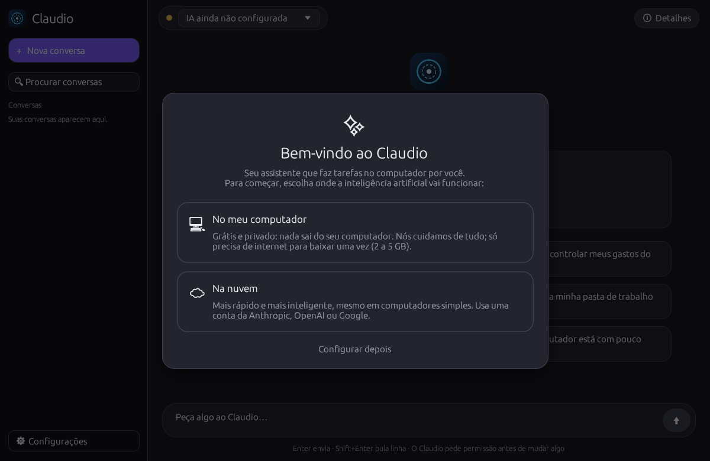
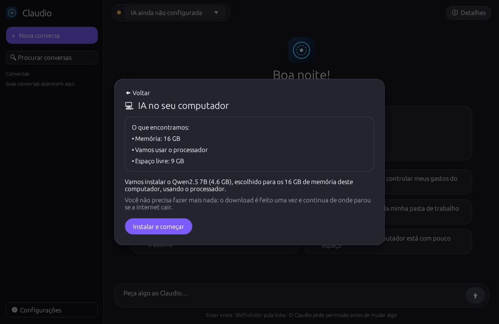
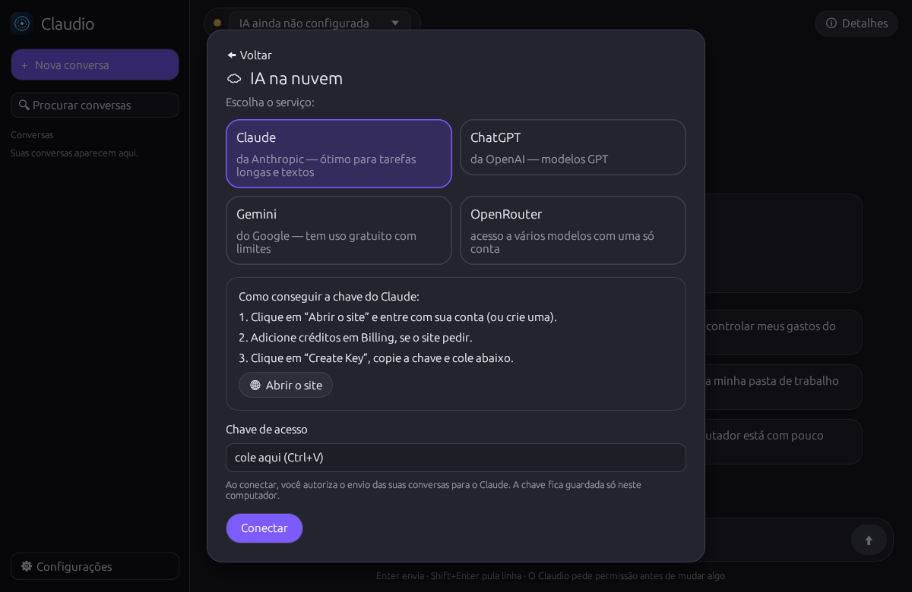
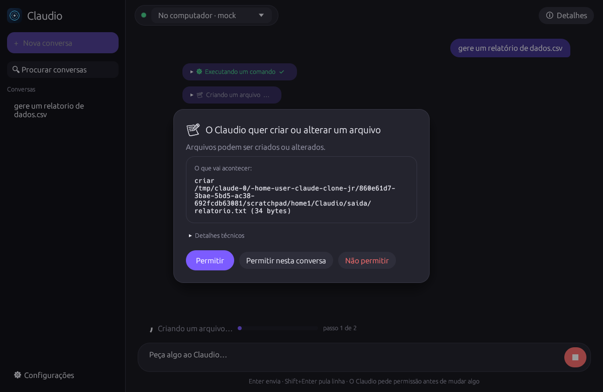
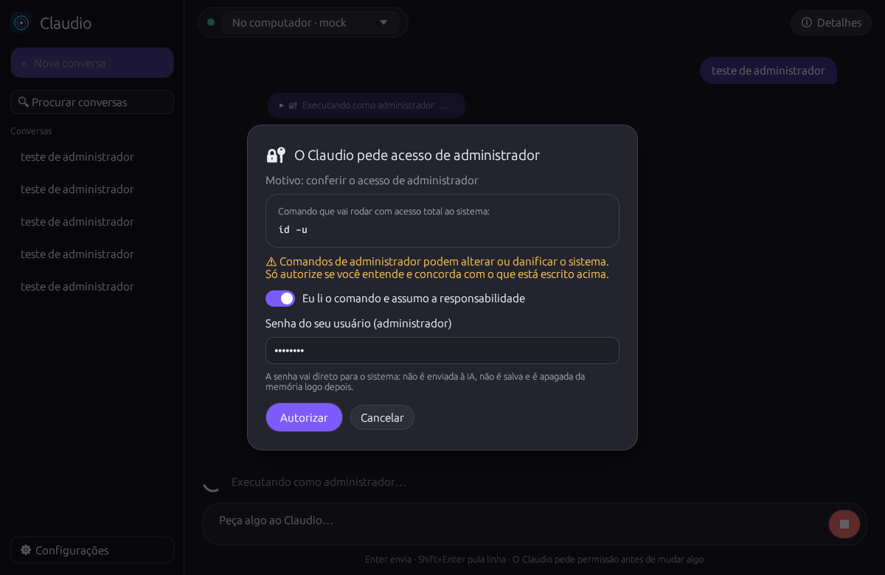
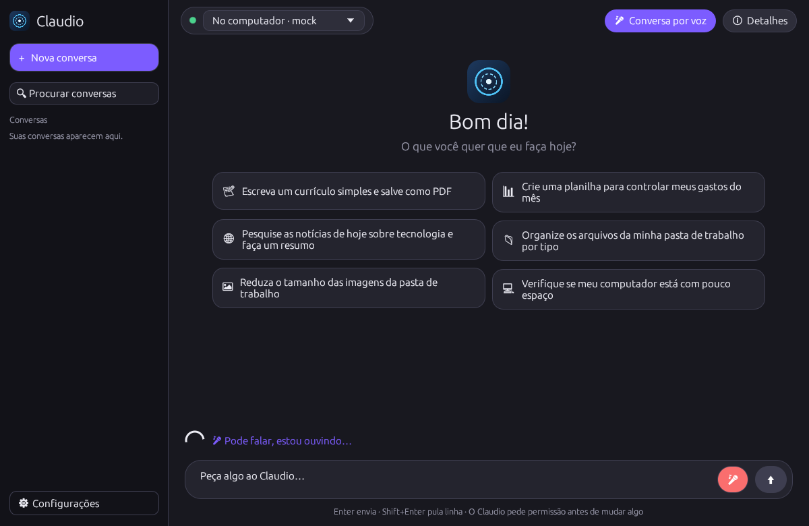
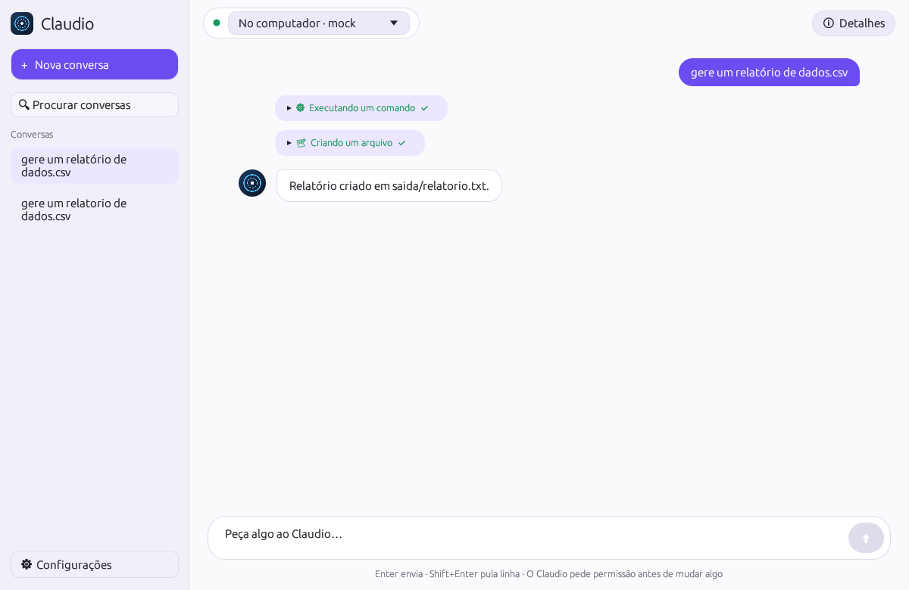

# Claudio Code

Agente de IA autônomo, local-first e open source (Apache-2.0), escrito em Rust.
Roda em **Linux, Windows e macOS**. Ele **planeja, executa e verifica** tarefas
usando ferramentas reais: arquivos, terminal, web, navegador, documentos (PDF, DOCX, XLSX, CSV, PPTX, LaTeX),
áudio, vídeo, imagens, memória persistente, workflows, agendamentos, MCP e skills.
A CLI `claudio` e a interface gráfica `claudio-gui` usam o mesmo núcleo.

**Feito para qualquer pessoa:** na primeira vez, um assistente pergunta só onde a IA vai funcionar
(no computador, grátis, ou na nuvem) e faz o resto sozinho — detecta memória e placa de vídeo, escolhe o
modelo, instala e baixa tudo com uma barra de progresso. Nenhum termo técnico é necessário.



O que ele faz no dia a dia:

- **Conversa por texto e por voz em tempo real**: você fala, ele entende quando você termina, responde em voz
  alta e volta a ouvir. O reconhecimento de voz roda no próprio computador ([docs/VOICE.md](docs/VOICE.md)).
- **Pesquisa na internet** e cita as fontes; **usa o navegador** como você (abre sites, clica, preenche,
  tira foto da tela) numa janela que você acompanha.
- **Arquivos, documentos, planilhas, PDF e LaTeX**: cria, lê, edita e converte.
- **Executa tarefas no computador**: comandos, programas, diagnóstico do sistema. Para mudanças de sistema
  (instalar programas, configurações), mostra o comando e **pede a sua senha de administrador** —
  com a responsabilidade do usuário.
- **APIs e serviços externos** (`http_request`), **MCP**, automações e agendamentos.
- **Lembra** o que for útil e **é honesto**: pesquisa quando não sabe, corrige você com educação quando algo
  está errado, admite e corrige os próprios erros, e confere o resultado antes de dizer que terminou.

- **Modelos locais** via llama.cpp (`llama-server`), sem conta e sem custo por uso. O Claudio inicia o servidor sozinho.
- **Modelos por API** (Anthropic, Gemini, OpenAI e compatíveis), opcionais, com consentimento explícito.
- **Segurança**: permissões por ferramenta e por risco, aprovação para ações de escrita/execução/destrutivas,
  comandos de administrador só com a sua senha (sudo/UAC) a cada vez, limites de diretório, isolamento com bubblewrap, proteção contra injeção
  de prompt e auditoria com encadeamento de hash. Detalhes em [SECURITY.md](SECURITY.md).

Documentos: [ARCHITECTURE.md](ARCHITECTURE.md) · [SECURITY.md](SECURITY.md) · [ROADMAP.md](ROADMAP.md) ·
[docs/MODELOS-LOCAIS.md](docs/MODELOS-LOCAIS.md) · [docs/VOICE.md](docs/VOICE.md) · [docs/EXTENSOES.md](docs/EXTENSOES.md)

## Instalação

Baixe o pacote do seu sistema na página de
[Releases](https://github.com/littlefarm7/claude-clone-jr/releases).

| Sistema | Arquivo | Como usar |
|---|---|---|
| Linux (LMDE, Debian, Ubuntu, Fedora…) | `Claudio_Code-<versão>-x86_64.AppImage` | `chmod +x` e execute. Sem argumentos abre a GUI; com argumentos é a CLI. |
| Linux (binários soltos) | `Claudio_Code-<versão>-linux-x86_64.tar.gz` | `claudio` e `claudio-gui` |
| Windows 10/11 (x64) | `Claudio_Code-<versão>-windows-x86_64.zip` | extraia; abra `claudio-gui.exe`; CLI: `.\claudio.exe` |
| macOS 11+ (Apple Silicon e Intel) | `Claudio_Code-<versão>-macos-universal.dmg` | arraste **Claudio Code** para Aplicativos |
| macOS (CLI) | `Claudio_Code-<versão>-macos-universal.tar.gz` | `claudio` e `claudio-gui` |

Observações:
1. **Linux:** o AppImage exige glibc 2.31 ou mais nova. Sem FUSE, use `--appimage-extract-and-run`
   ou `sudo apt install libfuse2`.
2. **Windows:** o SmartScreen pode avisar (executável sem assinatura comercial). Clique em
   “Mais informações” → “Executar assim mesmo”.
3. **macOS:** o app tem assinatura ad hoc, sem notarização. Na primeira vez, clique com o botão direito
   em **Claudio Code** → **Abrir**, ou rode `xattr -dr com.apple.quarantine "/Applications/Claudio Code.app"`.
   A CLI fica em `/Applications/Claudio Code.app/Contents/MacOS/claudio`.
4. Verifique a integridade com `SHA256SUMS.txt`.

### Compilar a partir do código

1. Instale o Rust: <https://rustup.rs> (a versão é fixada em `rust-toolchain.toml`).
2. Compile: `cargo build --release`.
3. Pacotes:
   - Linux: `./scripts/build-appimage.sh`
   - macOS: `./scripts/build-macos.sh`
   - Windows: `pwsh -File scripts/build-windows.ps1`

### Diferenças entre sistemas

| Recurso | Linux | macOS | Windows |
|---|---|---|---|
| Terminal do agente | bash | bash | PowerShell |
| Isolamento do terminal | bubblewrap | `sandbox-exec` (nativo) | não disponível (aprovações continuam obrigatórias) |
| Lixeira (`delete_path`) | freedesktop | Lixeira do Finder | Lixeira do Windows |
| Voz (síntese) | espeak-ng / piper | `say` nativo / piper | SAPI nativo / piper |
| Microfone | arecord / ffmpeg | ffmpeg (AVFoundation) | ffmpeg (DirectShow) |
| Navegador headless | Chromium/Chrome | Chrome/Chromium/Edge | Edge/Chrome |
| PDF | poppler, ou leitor interno | poppler (brew), ou leitor interno | poppler, ou leitor interno |
| Configuração | `~/.config/claudio` | `~/Library/Application Support/claudio` | `%APPDATA%\claudio` |

## Primeiros passos

1. Abra o aplicativo (o AppImage, o app do macOS ou `claudio-gui.exe` no Windows).
2. Na tela de boas-vindas, escolha **uma** opção:



### Opção A — No meu computador (grátis e privado)

1. Clique em **No meu computador**. O Claudio mostra o que encontrou (memória, placa de vídeo, espaço livre)
   e qual IA vai instalar.
2. Clique em **Instalar e começar**. Ele baixa o motor de IA e o modelo (2 a 5 GB, uma vez só).
   Se a internet cair, o download continua de onde parou.
3. Pronto. Nada do que você escreve sai do computador.

Como ele escolhe: 8,5 GB de memória ou mais → Qwen2.5 7B; de 5 a 8 GB → Qwen2.5 3B; menos → Qwen2.5 1.5B.
Com placa AMD/NVIDIA e Vulkan instalado, usa a placa de vídeo; no Mac com chip Apple, usa o Metal.
Se a placa de vídeo falhar ao iniciar, ele volta sozinho para o processador.



### Opção B — Na nuvem (mais rápida, precisa de uma conta)

1. Clique em **Na nuvem** e escolha o serviço: **Claude**, **ChatGPT**, **Gemini** ou **OpenRouter**.
2. Siga os passos da tela: **Abrir o site** → criar a chave → copiar.
3. Cole a chave e clique em **Conectar**. O Claudio testa na hora e avisa em português se algo estiver errado
   (chave incompleta, sem créditos, sem internet).

A chave fica só neste computador, num arquivo protegido separado da configuração, que as ferramentas do
agente não conseguem ler. Conectar é a sua autorização para enviar as conversas a esse serviço.



### No dia a dia

- Escreva o pedido e tecle **Enter** (Shift+Enter pula linha). Há sugestões na tela inicial.
- Antes de criar, mudar ou apagar algo, o Claudio **pede permissão** explicando o que vai acontecer.
- Para falar com ele, clique no **🎤** (ou ligue **Conversa por voz**). Na primeira vez ele oferece ativar a
  voz com um clique (~250 MB, tudo no computador).
- Se uma tarefa precisar de administrador (por exemplo instalar um programa), aparece uma tela com o comando
  exato: você lê, marca “assumo a responsabilidade” e digita a senha. Ela vai direto para o sistema.
- Os arquivos que ele cria ficam na pasta **Documentos/Claudio**.
- Tarefas longas podem ser pausadas e continuadas com **Continuar de onde parou**.
- **Configurações** tem só o essencial (IA, pasta, permissões, privacidade, tema claro/escuro).
  Modelos, chaves e limites manuais ficam em **Mostrar opções avançadas**.









### Pelo terminal (mesmas opções)

```bash
claudio models providers                       # provedores de API
claudio models add-api --provider anthropic --default   # pede a chave sem mostrá-la
claudio models test claude                     # confere se responde
claudio llama-install --variant vulkan         # instala o llama-server (cpu ou vulkan)
claudio models catalog                         # modelos locais recomendados
claudio models download qwen2.5-7b            # baixa e passa a usar
claudio models use-file ~/modelos/meu.gguf     # usa um .gguf existente
claudio models use claude                      # troca o modelo padrão
claudio voice setup                            # ativa a conversa por voz (uma vez)
claudio voice chat                             # conversa por voz no terminal
claudio secret set GITHUB_TOKEN                # chave usada pelo agente como {{secret:GITHUB_TOKEN}}
```

Depois: `claudio doctor` mostra o que está instalado, e `claudio` abre a conversa no terminal.
Por padrão o agente só grava dentro da pasta de trabalho (`Documentos/Claudio` quando configurado pelo
assistente; `~/claudio-work` na CLI). Altere em **Configurações**.

Para redes que bloqueiam GitHub ou Hugging Face, defina espelhos: `CLAUDIO_LLAMA_RELEASES_API`
(API de releases no formato do GitHub) e `CLAUDIO_MODELS_MIRROR` (URL que serve os `.gguf` pelo nome).

## Comandos principais

| Comando | O que faz |
|---|---|
| `claudio` / `claudio chat` | Conversa interativa (`/modelo`, `/nova`, `/plano`, `/sair`) |
| `claudio run "tarefa"` | Executa até concluir e verificar; `--detach` roda em segundo plano |
| `claudio resume <id>` | Retoma uma sessão interrompida ou parada por limite |
| `claudio sessions` · `show <id>` · `history <texto>` | Histórico |
| `claudio memory list/add/search/delete/clear` | Memória controlada pelo usuário |
| `claudio models` · `serve <gguf>` | Modelos e servidor local |
| `claudio workflow arquivo.toml` | Executa um workflow |
| `claudio schedule add/list/delete` · `daemon` | Agendamentos (cron) |
| `claudio voice transcribe/say/listen` | Voz local |
| `claudio audit verify/tail` | Auditoria |
| `claudio consent list/revoke` | Consentimentos de provedores remotos |
| `claudio tools` · `doctor` | Ferramentas e diagnóstico |

Opções globais: `--model <nome>`, `--yes` (aprova escrita/execução/rede; nunca ações destrutivas ou
administrativas), `--non-interactive`, `--json`, `--config <arquivo>`.

## Como o agente trabalha

1. **Planeja**: chama `update_plan` com os passos. O plano aparece na GUI e na CLI.
2. **Executa**: cada ferramenta passa por validação, política de permissão, aprovação, timeout e auditoria.
3. **Verifica**: ao terminar, abre uma fase de verificação. O modelo precisa conferir o resultado com
   ferramentas e responder `VERDICT: PASS` ou `VERDICT: FAIL`. “PASS” sem evidência é recusado.
   Falhas voltam para a execução.
4. **Persiste**: cada passo vai para o SQLite; sessões interrompidas podem ser retomadas.

Limites configuráveis em `[agent]`: iterações, chamadas ao modelo, chamadas de ferramenta, tempo, tokens,
tamanho da saída e timeout por ferramenta.

## Ferramentas

| Grupo | Ferramentas |
|---|---|
| Arquivos | `read_file`, `write_file`, `edit_file`, `list_dir`, `glob`, `grep`, `delete_path` (lixeira), `move_path` |
| Terminal | `shell` (com isolamento bubblewrap), `admin_command` (sudo/UAC com a senha do usuário), `job_status` (segundo plano), `system_info`, `process_list` |
| Web | `web_search` (SearXNG, Brave ou DuckDuckGo), `web_fetch` (anti‑SSRF), `browser_session` (navegador interativo: abrir, ler, clicar, digitar, capturar), `browser` (Chromium headless: texto, captura, PDF), `http_request` (APIs com chaves `{{secret:NOME}}`) |
| Documentos | `doc_read`, `doc_create`, `doc_convert`, `latex_compile` |
| Multimídia | `media_info`, `media_convert` (ffmpeg), `image_edit`, `ocr` (Tesseract), `transcribe` (whisper.cpp embutido), `speak` (piper/espeak-ng/say/SAPI) |
| Memória | `memory_save`, `memory_search`, `history_search` |
| Extensões | MCP (`mcp__servidor__ferramenta`), `skill_load`, ferramentas customizadas TOML |
| Subagentes | `delegate_task` |

Modelos com contexto pequeno recebem só as ferramentas essenciais, para caber na janela.

## Modelos por API (opcional)

Defina as chaves por variável de ambiente (recomendado): `ANTHROPIC_API_KEY`, `GEMINI_API_KEY`, `OPENAI_API_KEY`.
No primeiro uso de cada provedor remoto o Claudio pede consentimento. Com `privacy.local_only = true`, nenhum
provedor remoto é usado. A seleção automática considera o tipo de tarefa (`fast`, `smart`, `code`, `long`,
`vision`), a disponibilidade (chave, servidor local respondendo) e a RAM livre frente ao tamanho do GGUF.

## Automação

- Workflows TOML com passos de ferramenta e de tarefa, variáveis e ferramentas pré‑aprovadas:
  veja [examples/workflows](examples/workflows).
- Agendamentos: `claudio schedule add --name diario --cron "0 8 * * 1-5" --task "resuma meus e-mails exportados"`.
- O `claudio daemon` executa os agendamentos. Para iniciar com a sessão do usuário:
  `cp packaging/systemd/claudio-daemon.service ~/.config/systemd/user/ && systemctl --user enable --now claudio-daemon`.
- O daemon não abre portas de rede.

## Testes

```bash
cargo test --workspace
```

Os testes usam ferramentas reais (processos, arquivos, ffmpeg, Chromium, pandoc, LibreOffice, Tesseract,
pdflatex, bubblewrap, espeak-ng quando instalados) e um servidor de modelo scriptado em Python
([tests/fixtures/mock_llm.py](tests/fixtures/mock_llm.py)) para rodar o binário `claudio` de ponta a ponta.
Testes que dependem de algo ausente imprimem “ignorado” e passam.

Testes opcionais com llama.cpp real:

```bash
python3 -I scripts/make_tiny_gguf.py ~/llama.cpp /tmp/tiny.gguf    # modelo minúsculo de pesos aleatórios
CLAUDIO_TEST_GGUF=/tmp/tiny.gguf cargo test -p claudio-tools --test local_llama
```

## Estado atual e limitações

Os testes automatizados rodam no CI em Linux, macOS e Windows a cada commit. Resumo em [ROADMAP.md](ROADMAP.md).

- A qualidade das decisões depende do modelo. Modelos locais de 7–8B funcionam para tarefas simples e médias;
  tarefas longas rendem mais com modelos maiores ou por API.
- As APIs Anthropic, Gemini e OpenAI foram testadas contra servidores HTTP simulados com o formato oficial.
  Não houve chamada real por falta de chaves no ambiente de desenvolvimento.
- O modelo local foi testado com `llama-server` real e um GGUF de pesos aleatórios. O download de modelos reais
  estava bloqueado na rede do ambiente de desenvolvimento.
- Transcrição (whisper.cpp) e piper estão implementados, mas não foram testados por falta de modelos de voz no
  ambiente; espeak-ng e Tesseract foram testados.
- Automação de navegador é headless e não interativa (sem cliques/formulários). Veja o ROADMAP.

## Licença

Apache-2.0. Veja [LICENSE](LICENSE).

## Nome

Até a versão 0.2 o projeto se chamava “Jarvis Core”. Na primeira execução da 0.3, as pastas antigas de
configuração e dados (`jarvis`) são movidas para `claudio` automaticamente.
