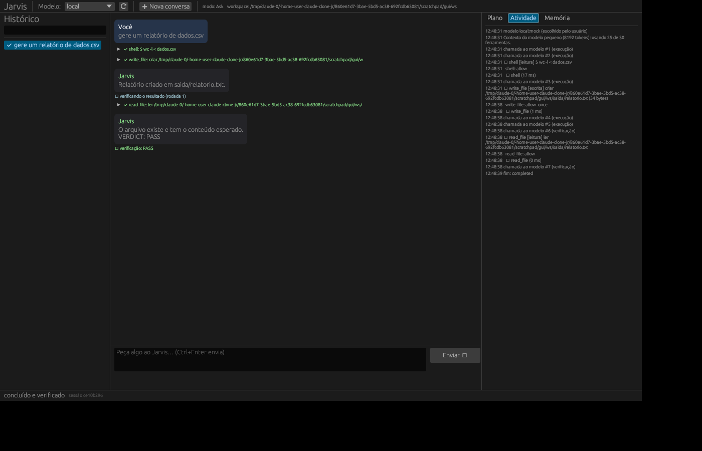

# Jarvis Core

Agente de IA autônomo, local-first e open source, escrito em Rust. Ele **planeja, executa e verifica** tarefas
usando ferramentas reais: arquivos, terminal, web, navegador, documentos (PDF, DOCX, XLSX, CSV, PPTX, LaTeX),
áudio, vídeo, imagens, memória persistente, workflows, agendamentos, MCP e skills.
A CLI `jarvis` e a interface gráfica `jarvis-gui` usam o mesmo núcleo.



- **Modelos locais** via llama.cpp (`llama-server`), sem conta e sem custo por uso. O Jarvis inicia o servidor sozinho.
- **Modelos por API** (Anthropic, Gemini, OpenAI e compatíveis), opcionais, com consentimento explícito.
- **Segurança**: permissões por ferramenta e por risco, aprovação para ações de escrita/execução/destrutivas,
  `sudo` nunca aprovado automaticamente, limites de diretório, isolamento com bubblewrap, proteção contra injeção
  de prompt e auditoria com encadeamento de hash. Detalhes em [SECURITY.md](SECURITY.md).

Documentos: [ARCHITECTURE.md](ARCHITECTURE.md) · [SECURITY.md](SECURITY.md) · [ROADMAP.md](ROADMAP.md) ·
[docs/MODELOS-LOCAIS.md](docs/MODELOS-LOCAIS.md) · [docs/VOICE.md](docs/VOICE.md) · [docs/EXTENSOES.md](docs/EXTENSOES.md)

## Instalação

### Opção 1 — AppImage

1. Baixe `Jarvis_Core-0.1.0-x86_64.AppImage` (ou gere com `./scripts/build-appimage.sh`).
2. Dê permissão: `chmod +x Jarvis_Core-0.1.0-x86_64.AppImage`.
3. Abra a interface: `./Jarvis_Core-0.1.0-x86_64.AppImage`.
4. Use a CLI pelo mesmo arquivo: `./Jarvis_Core-0.1.0-x86_64.AppImage doctor`.

O binário exige apenas glibc 2.31 ou mais nova (LMDE 5, 6 e 7 servem). Se o AppImage não abrir por falta de FUSE,
rode `sudo apt install libfuse2` ou use `--appimage-extract-and-run`.

### Opção 2 — a partir do código

1. Instale o Rust: <https://rustup.rs>.
2. Instale as dependências de sistema (o script só **mostra** os comandos; ele não usa sudo):
   `./scripts/deps-lmde.sh`.
3. Compile: `cargo build --release`.
4. Os binários ficam em `target/release/jarvis` e `target/release/jarvis-gui`.

## Primeiros passos

1. Crie a configuração: `jarvis config init` (arquivo `~/.config/jarvis/config.toml`, permissão 0600).
2. Verifique o ambiente: `jarvis doctor`.
3. Configure um modelo local (veja [docs/MODELOS-LOCAIS.md](docs/MODELOS-LOCAIS.md)):
   - compile o llama.cpp;
   - baixe um GGUF, por exemplo Qwen2.5‑7B‑Instruct Q4_K_M;
   - em `[[models]]` do modelo `local`, defina `gguf_path = "~/modelos/arquivo.gguf"`.
4. Confira: `jarvis models`.
5. Use:
   - interface gráfica: `jarvis-gui`;
   - conversa no terminal: `jarvis`;
   - tarefa única: `jarvis run "organize os PDFs de ~/jarvis-work/entrada por ano"`.

Por padrão o agente só grava dentro de `~/jarvis-work`. Para liberar outra pasta, acrescente-a em
`permissions.workspace_roots`.

## Comandos principais

| Comando | O que faz |
|---|---|
| `jarvis` / `jarvis chat` | Conversa interativa (`/modelo`, `/nova`, `/plano`, `/sair`) |
| `jarvis run "tarefa"` | Executa até concluir e verificar; `--detach` roda em segundo plano |
| `jarvis resume <id>` | Retoma uma sessão interrompida ou parada por limite |
| `jarvis sessions` · `show <id>` · `history <texto>` | Histórico |
| `jarvis memory list/add/search/delete/clear` | Memória controlada pelo usuário |
| `jarvis models` · `serve <gguf>` | Modelos e servidor local |
| `jarvis workflow arquivo.toml` | Executa um workflow |
| `jarvis schedule add/list/delete` · `daemon` | Agendamentos (cron) |
| `jarvis voice transcribe/say/listen` | Voz local |
| `jarvis audit verify/tail` | Auditoria |
| `jarvis consent list/revoke` | Consentimentos de provedores remotos |
| `jarvis tools` · `doctor` | Ferramentas e diagnóstico |

Opções globais: `--model <nome>`, `--yes` (aprova escrita/execução/rede; nunca ações destrutivas ou
administrativas), `--non-interactive`, `--json`, `--config <arquivo>`.

## Como o agente trabalha

1. **Planeja**: chama `update_plan` com os passos. O plano aparece na GUI e na CLI.
2. **Executa**: cada ferramenta passa por validação, política de permissão, aprovação, timeout e auditoria.
3. **Verifica**: ao terminar, abre uma fase de verificação. O modelo precisa conferir o resultado com
   ferramentas e responder `VERDICT: PASS` ou `VERDICT: FAIL`. “PASS” sem evidência é recusado.
   Falhas voltam para a execução.
4. **Persiste**: cada passo vai para o SQLite; sessões interrompidas podem ser retomadas.

Limites configuráveis em `[agent]`: iterações, chamadas ao modelo, chamadas de ferramenta, tempo, tokens,
tamanho da saída e timeout por ferramenta.

## Ferramentas

| Grupo | Ferramentas |
|---|---|
| Arquivos | `read_file`, `write_file`, `edit_file`, `list_dir`, `glob`, `grep`, `delete_path` (lixeira), `move_path` |
| Terminal | `shell` (com isolamento bubblewrap), `job_status` (segundo plano), `system_info`, `process_list` |
| Web | `web_search` (SearXNG, Brave ou DuckDuckGo), `web_fetch` (anti‑SSRF), `browser` (Chromium headless: texto, captura, PDF) |
| Documentos | `doc_read`, `doc_create`, `doc_convert`, `latex_compile` |
| Multimídia | `media_info`, `media_convert` (ffmpeg), `image_edit`, `ocr` (Tesseract), `transcribe` (whisper.cpp), `speak` (piper/espeak-ng) |
| Memória | `memory_save`, `memory_search`, `history_search` |
| Extensões | MCP (`mcp__servidor__ferramenta`), `skill_load`, ferramentas customizadas TOML |
| Subagentes | `delegate_task` |

Modelos com contexto pequeno recebem só as ferramentas essenciais, para caber na janela.

## Modelos por API (opcional)

Defina as chaves por variável de ambiente (recomendado): `ANTHROPIC_API_KEY`, `GEMINI_API_KEY`, `OPENAI_API_KEY`.
No primeiro uso de cada provedor remoto o Jarvis pede consentimento. Com `privacy.local_only = true`, nenhum
provedor remoto é usado. A seleção automática considera o tipo de tarefa (`fast`, `smart`, `code`, `long`,
`vision`), a disponibilidade (chave, servidor local respondendo) e a RAM livre frente ao tamanho do GGUF.

## Automação

- Workflows TOML com passos de ferramenta e de tarefa, variáveis e ferramentas pré‑aprovadas:
  veja [examples/workflows](examples/workflows).
- Agendamentos: `jarvis schedule add --name diario --cron "0 8 * * 1-5" --task "resuma meus e-mails exportados"`.
- O `jarvis daemon` executa os agendamentos. Para iniciar com a sessão do usuário:
  `cp packaging/systemd/jarvis-daemon.service ~/.config/systemd/user/ && systemctl --user enable --now jarvis-daemon`.
- O daemon não abre portas de rede.

## Testes

```bash
cargo test --workspace
```

Os testes usam ferramentas reais (processos, arquivos, ffmpeg, Chromium, pandoc, LibreOffice, Tesseract,
pdflatex, bubblewrap, espeak-ng quando instalados) e um servidor de modelo scriptado em Python
([tests/fixtures/mock_llm.py](tests/fixtures/mock_llm.py)) para rodar o binário `jarvis` de ponta a ponta.
Testes que dependem de algo ausente imprimem “ignorado” e passam.

Testes opcionais com llama.cpp real:

```bash
python3 -I scripts/make_tiny_gguf.py ~/llama.cpp /tmp/tiny.gguf    # modelo minúsculo de pesos aleatórios
JARVIS_TEST_GGUF=/tmp/tiny.gguf cargo test -p jarvis-tools --test local_llama
```

## Estado atual e limitações

Testado neste repositório (Ubuntu 24.04 x86_64 em container, sem GPU): veja o resumo em [ROADMAP.md](ROADMAP.md).

- A qualidade das decisões depende do modelo. Modelos locais de 7–8B funcionam para tarefas simples e médias;
  tarefas longas rendem mais com modelos maiores ou por API.
- As APIs Anthropic, Gemini e OpenAI foram testadas contra servidores HTTP simulados com o formato oficial.
  Não houve chamada real por falta de chaves no ambiente de desenvolvimento.
- O modelo local foi testado com `llama-server` real e um GGUF de pesos aleatórios. O download de modelos reais
  estava bloqueado na rede do ambiente de desenvolvimento.
- Transcrição (whisper.cpp) e piper estão implementados, mas não foram testados por falta de modelos de voz no
  ambiente; espeak-ng e Tesseract foram testados.
- Automação de navegador é headless e não interativa (sem cliques/formulários). Veja o ROADMAP.

## Licença

Apache-2.0. Veja [LICENSE](LICENSE).
